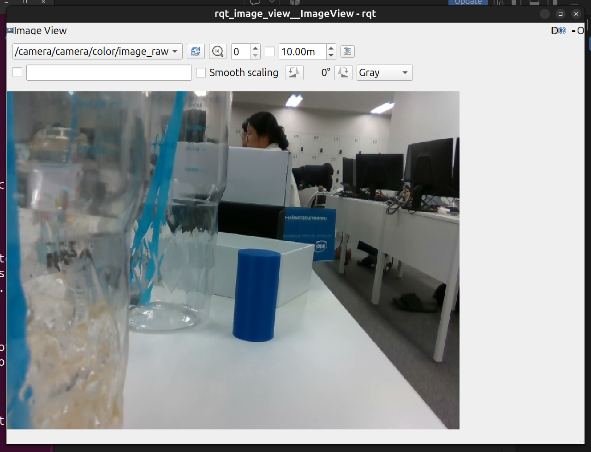
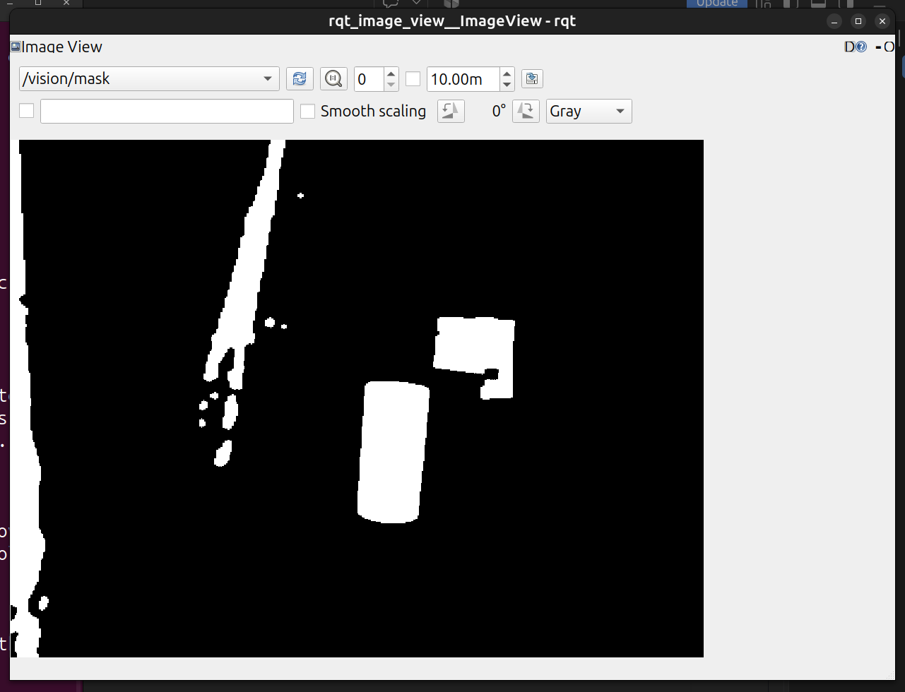
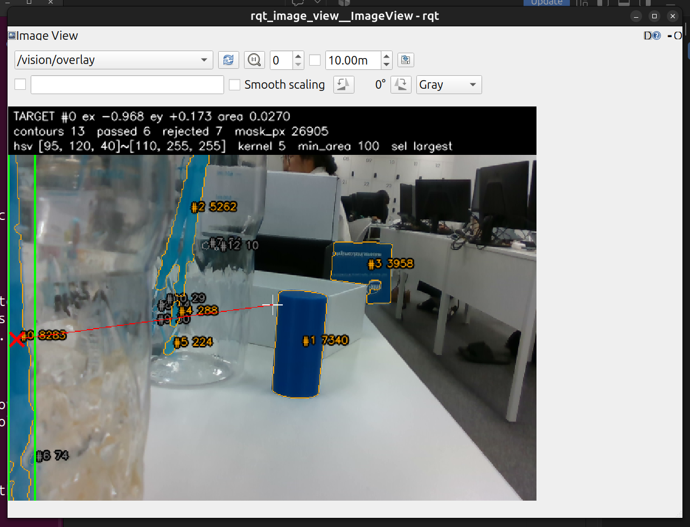
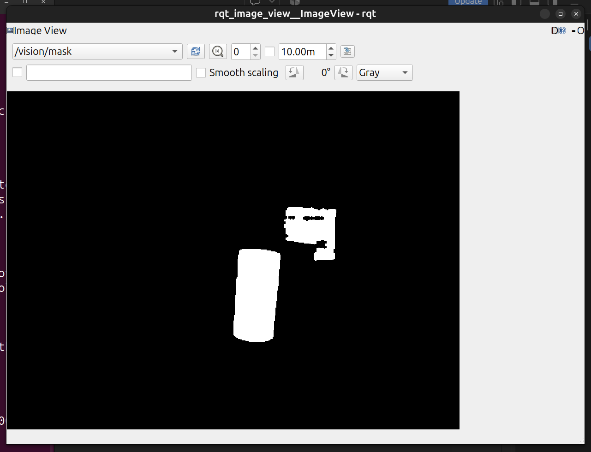
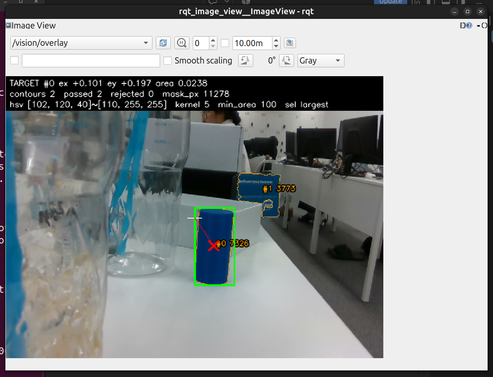
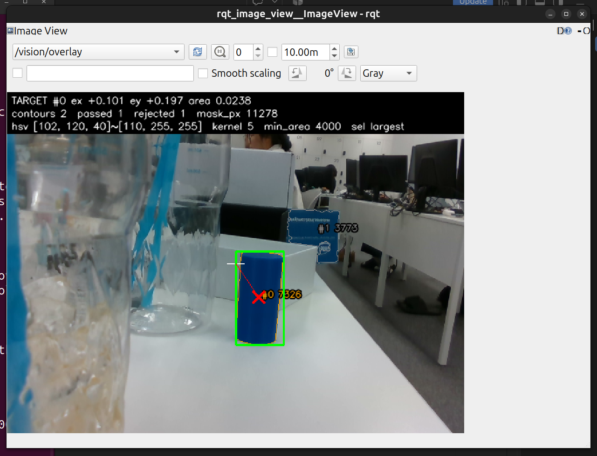

# 모듈 3 보고서 — HSV 설정값에 따른 Mask·검출 결과 변화

실행일: 2026-10-12. 아래 수치는 모두 ROS 2 토픽으로 받은 메시지(`results/`의 JSON·이미지·로그)에서 옮겼다. 추정한 내용은 "추정"이라고 표시했다.

## 1. 실행 환경과 입력

| 항목 | 값 |
|---|---|
| 코드 | `lv2_module3/vision_basic` (이 저장소). 원본: 팀 저장소 [Lv2_Monglian_Assignment](https://github.com/Lv2-Monglian-Assignment/Lv2_Monglian_Assignment) 커밋 `cc96e83`의 `lv2_module5/ros2_ws/src/target_detector` (인지 부분을 직접 작성). HSV 검출 단계만 재구성했고 알고리즘·기준값은 같다 |
| 실행 파일 | `vision_node`(검출), `image_file_publisher`(고정 입력), `topic_snapshot`(토픽 구독 저장), `scripts/run_ab.sh`·`scripts/rqt_capture.sh` |
| PC | Ubuntu 24.04, ROS 2 Lyrical, Python 3.12.3, OpenCV 4.6.0, NumPy 1.26.4, cv_bridge 4.1.0, rqt_image_view 2.0.5 |
| 카메라 | Intel RealSense D435 (FW 5.17.0.10), realsense2_camera 4.57.7, PC USB 3 (5000M) 직결, 컬러 640×480 rgb8 30 Hz, 자동 노출 |
| 통신 | `ROS_DOMAIN_ID=31`, `ROS_AUTOMATIC_DISCOVERY_RANGE=LOCALHOST`, `rmw_cyclonedds_cpp` (같은 네트워크의 로봇과 섞이지 않게 분리) |

### 입력

| 용도 | 입력 | 근거 |
|---|---|---|
| 실험 1·2 (A·B 4묶음) | 고정 이미지 `results/input/camera_scene_raw.png`. D435 실시간 영상을 `/camera/camera/color/image_raw` 토픽으로 받아 저장한 한 프레임(stamp 1791788005.129537109)을 `image_file_publisher`로 같은 토픽에 5 Hz 반복 발행 | `results/input/camera_scene_topics.json`, `results/topics/topic_list.txt` |
| 목표 없음 확인 | D435 실시간 (`source:=camera`). 같은 위치에서 원기둥·상자를 치운 장면 | `results/no_target/` |

같은 장면을 실시간으로 쓰지 않고 한 프레임을 고정한 이유: 자동 노출·센서 잡음으로 프레임마다 픽셀 값이 달라지면 A·B 차이가 설정 때문인지 입력 때문인지 구분할 수 없다. 4묶음의 Raw Image가 입력 파일과 픽셀 단위로 같은지 비교했고 모두 같았다(`np.array_equal` = True).

### 실행 명령

```bash
# 실험 1·2: 고정 입력
ros2 launch vision_basic vision.launch.py source:=image image_path:=results/input/camera_scene_raw.png rate_hz:=5.0
scripts/run_ab.sh results/exp1_mask exp1 hsv_lower "[102, 120, 40]" "[95, 120, 40]"
scripts/run_ab.sh results/exp2_filter exp2 min_area_px 100.0 4000.0
# 목표 없음: 실시간 카메라
ros2 launch vision_basic vision.launch.py source:=camera
ros2 run vision_basic topic_snapshot --ros-args -p out_dir:=results/no_target -p label:=no_target -p count:=3 -p skip:=5
```

## 2. 토픽 구성

| 자료 | 토픽 이름 | 메시지 타입 | 발행 노드 | 수신 도구 |
|---|---|---|---|---|
| Raw Image | `/camera/camera/color/image_raw` | `sensor_msgs/msg/Image` | `/camera/camera` (실시간) · `/image_file_publisher` (고정 입력) | rqt_image_view |
| Mask | `/vision/mask` | `sensor_msgs/msg/Image` (mono8) | `/vision_node` | rqt_image_view |
| 검출 결과 (Overlay) | `/vision/overlay` | `sensor_msgs/msg/Image` (bgr8) | `/vision_node` | rqt_image_view |
| 검출 결과 (수치) | `/vision/target` | `geometry_msgs/msg/PointStamped` | `/vision_node` | `ros2 topic echo` · `topic_snapshot` |
| 검출 결과 (상세) | `/vision/detections` | `std_msgs/msg/String` (JSON) | `/vision_node` | `ros2 topic echo --field data` · `topic_snapshot` |

- 근거: `results/topics/topic_list.txt`(노드·토픽 목록), `topic_info.txt`(발행·구독 노드, QoS), `camera_topic_*.txt`(실시간 카메라 구성), `interface_show.txt`(메시지 정의).
- QoS: 출력 4개는 RELIABLE·KEEP_LAST 1이다. 입력 구독은 BEST_EFFORT라서 카메라(BEST_EFFORT)와 고정 입력·bag(RELIABLE) 발행자 모두와 호환된다. rqt_image_view는 RELIABLE 발행자에 붙는다.
- 수신 주기: 고정 입력에서 입력·Overlay 모두 5.00 Hz(`results/topics/topic_rate.txt`). 실시간 카메라에서 입력 29.99 Hz, `/vision/target` 29.98 Hz(`results/no_target/no_target_rate.txt`). 처리 노드가 입력 프레임마다 결과를 하나씩 낸다.

### 2.1 Raw Image



- 640×480, encoding `rgb8`, frame_id `camera_color_optical_frame` (`results/input/camera_scene_topics.json`).
- 흰 책상 위 가운데에 진한 파란 원기둥(목표)이 있다. 그 오른쪽 뒤에 파란 RealSense 상자가 비스듬히 서 있고, 왼쪽 앞에는 청록색 빨대가 꽂힌 투명 컵이 카메라에 가깝게(초점 밖) 놓여 있다. 배경은 강의실 책상·모니터·사람이다.

### 2.2 Mask


- 전경(255)은 HSV 세 채널이 모두 `hsv_lower ≤ 값 ≤ hsv_upper`인 픽셀을 남기고, 5 px 타원 커널로 open(작은 점 제거) → close(구멍 메우기)한 결과다. 나머지는 배경(0)이다. 면적 필터 **이전** 단계다.
- 기준 설정에서 남은 영역: 원기둥(Contour 면적 7325.5 px²)과 상자의 파란 면(3773 px²). Mask 전경 픽셀은 모두 11278개다. 상자의 흰 글씨·로고는 파랑이 아니라서 상자 Mask 안에 구멍으로 남았다. 빨대는 하나도 남지 않았다.
- 목표 외에 함께 남은 영역은 상자다. 상자는 목표와 같은 파란색이라 HSV만으로는 구분할 수 없다(실험 2의 대상). 원기둥 Mask는 윤곽이 매끈하고 누락된 부분이 없었다.
- 코드 위치
  - Mask 생성: `vision_basic/pipeline/mask.py` `build_mask()` — `cv2.inRange`(21행), open·close(25·26행).
  - 발행: `vision_basic/nodes/vision_node.py` `_on_image()`에서 `/vision/mask`로 보낸다(42행 publisher, 74행 publish).
  - 설정값 읽기: `vision_basic/ros/params.py` — 노드 시작 때 `declare_detection_params()`로 `config/vision.yaml` 값을 읽고, `read_config()`(63행)로 설정 객체를 만든다. 실행 중 `ros2 param set`은 `vision_node.py` `_on_set_params()`(48행)가 검증한 뒤 `Detector.reconfigure()`로 다음 프레임부터 적용하고 `config_rev`를 1 올린다(56·57행).

### 2.3 검출 결과

- `/vision/target` (PointStamped). 기준 설정·고정 입력에서 받은 값(`results/topics/echo_baseline.txt`):
  - `header`: 입력 영상의 stamp·frame_id를 그대로 복사한다.
  - `point.x` = ex = (cx − W/2)/(W/2) = **+0.1005** — 영상 중심 기준 가로 오차, 오른쪽 +, 범위 −1~1, 단위 없음.
  - `point.y` = ey = (cy − H/2)/(H/2) = **+0.1969** — 세로 오차, 아래 +.
  - `point.z` = Contour 면적 / (W×H) = **0.02385** — 면적비(거리가 아님).
  - 미검출이면 x = y = z = 0.
- `/vision/detections` (JSON): 같은 stamp의 `config`(적용 설정)·`config_rev`·`mask_pixels`·`contours_total`·`passed`(통과 후보: 면적 px², 중심 px, bbox [x,y,w,h])·`rejected`(탈락 후보와 사유)·`target`을 담는다. Bounding Box는 이 메시지에만 있고 `/vision/target`에는 없다.
- Overlay: 초록 박스(bbox [320,223,67,131])와 빨간 X(중심 352.2, 287.3)가 Raw Image의 원기둥 위치와 일치한다. 흰 십자는 영상 중심이다. 주황 선은 통과 후보, 회색 선은 탈락 후보다.
- 코드 위치: 후보 추출 `pipeline/candidates.py` `extract_candidates()`(13·16행) → 면적 필터 `filter_candidates()`(33행) → 선택 `pipeline/selection.py` `select_target()`(largest: 26행) → 메시지 변환 `ros/messages.py` `target_msg()`(20행) → 발행 `vision_node.py` 75~77행.

### 2.4 처리 흐름

```
/camera/camera/color/image_raw  (sensor_msgs/Image rgb8)
   │  vision_node._on_image()
   ▼
to_hsv (rgb8 → HSV)                                   pipeline/mask.py
   ▼
cv2.inRange(hsv_lower, hsv_upper) → open → close      ← 실험 1: hsv_lower
   ├──────────────► /vision/mask (mono8)
   ▼
findContours → contourArea                            pipeline/candidates.py
   ▼
contourArea < min_area_px 이면 탈락                   ← 실험 2: min_area_px
   ▼
select_target (largest: 가장 큰 통과 후보)            pipeline/selection.py
   ├──────────────► /vision/target (PointStamped: ex, ey, 면적비)
   ├──────────────► /vision/detections (JSON: 후보·탈락·설정)
   └──────────────► /vision/overlay (bgr8)
```

## 3. 실험 설계

| 실험 | 변경 변수 | A값 | B값 | 고정한 값 | 입력 | 예상 변화 (실행 전 작성) |
|---|---|---|---|---|---|---|
| 1 Mask 생성 | `hsv_lower`의 H | 102 | 95 | S·V 하한 120·40, 상한 [110,255,255], `morph_kernel` 5, `min_area_px` 100, `selection` largest | `results/input/camera_scene_raw.png` 고정 이미지 반복 발행 | 빨대(미리보기 측정 H 86~95)가 B에서 전경으로 들어와 Mask 픽셀·Contour 수가 늘어남. 빨대가 원기둥보다 크면 largest 규칙으로 목표가 빨대로 바뀜 |
| 2 후보 필터 | `min_area_px` | 100 | 4000 [px²] | HSV [102,120,40]~[110,255,255] 동일, `morph_kernel` 5, `selection` largest | 위와 같은 이미지 | Mask는 A·B가 같음. 기준 실행에서 면적 3773인 상자 후보만 B에서 탈락하고 원기둥(약 7300)은 남음 |

- 예상의 근거: 실행 전 같은 장면의 미리보기에서 빨대 몇 지점의 HSV와 기준 설정의 후보 면적을 측정했다. 빨대 HSV 중앙값은 (95, 194, 123), (88, 78, 59), (86, 48, 96) 등이었다(처음 미리보기 프레임에서 5×5 픽셀 중앙값).
- 값 적용 방법: 실행 중 `ros2 param set /vision_node <이름> <값>`. 적용 여부는 `ros2 param get` 응답과, 저장한 묶음 JSON의 `config`·`config_rev`로 프레임 단위로 확인했다. `topic_snapshot`은 설정 변경 뒤 3개 묶음을 건너뛰고 저장한다.
- 값을 고른 이유
  - H 102 vs 95: 기준 하한 102는 원기둥 실측 H 103~108에서 정한 값이다(팀 저장소 `config/hsv.yaml` 2026-10-05 실측). 95는 빨대 측정값의 위쪽 끝이라, H 하한을 "조금 넓히면" 바로 배경 청록색이 들어오는지 확인할 수 있다.
  - 100 vs 4000: 100은 기준값(점 잡음 14~55 px²보다 크게)이다. 4000은 이번 입력에서 상자(3773)와 원기둥(7326) 사이 값이다.

## 4. 실험 결과와 분석

| 묶음 | 위치 | 입력 stamp (seq) | config_rev |
|---|---|---|---|
| 실험 1 A | `results/exp1_mask/A/` | 1791788575.986846693 (2368) | 4 |
| 실험 1 B | `results/exp1_mask/B/` | 1791788597.786719123 (2477) | 5 |
| 실험 2 A | `results/exp2_filter/A/` | 1791788626.186899004 (2619) | 7 |
| 실험 2 B | `results/exp2_filter/B/` | 1791788647.986881723 (2728) | 8 |

각 폴더에 `*_raw.png`·`*_mask.png`·`*_overlay.png`(토픽 수신 이미지), `*_rqt_*.png`(rqt_image_view 화면), `*_detections.json`, `*_target.txt`, `*_echo_target.txt`, `*_topics.json`이 있다. 설정 변경 명령과 응답은 `commands.log`에 있다. config_rev 1~3은 첫 실행 시도에서 올라간 값이다. 이 시도는 다른 DOMAIN에 붙어 있던 이전 프로세스가 캡처 일부를 덮어써서 결과를 지우고 같은 노드에서 다시 실행했다.

### 4.1 실험 1 — `hsv_lower` H 102 → 95

- **가설:** `inRange`는 H가 하한 이상인 픽셀만 남긴다. 하한을 102에서 95로 낮추면 H 95~101 픽셀이 새로 전경이 된다. 빨대(H 약 86~95)의 H 95 부근 픽셀이 Mask에 들어오고, 빨대가 원기둥보다 크게 남으면 largest 선택이 빨대로 바뀔 것이다.
- **통제 조건:** 같은 고정 입력(4묶음 모두 입력 파일과 픽셀 동일). H 하한 외의 모든 값 고정: S·V 하한 120·40, 상한 [110,255,255], 커널 5, `min_area_px` 100, largest.

| 항목 | A (H 102) | B (H 95) |
|---|---|---|
| Mask 전경 픽셀 | 11278 | 26905 (×2.39) |
| Contour 수 | 2 | 13 |
| 통과 / 탈락 (min_area 100) | 2 / 0 | 6 / 7 (74, 54, 44.5, 30, 29, 14, 10 px²) |
| 통과 후보 [px²] | 원기둥 7325.5, 상자 3773 | 빨대(왼쪽 끝) 8283, 원기둥 7340.5, 빨대(컵 안) 5262.5, 상자 3957.5, 빨대 조각 287.5·224 |
| 선택 목표 | 원기둥 #0, 중심 (352.2, 287.3), bbox [320,223,67,131] | 빨대 #0, 중심 (10.3, 281.6), bbox [0,0,32,480] |
| `/vision/target` (ex, ey, 면적비) | (+0.1005, +0.1969, 0.02385) | (−0.9677, +0.1735, 0.02696) |
| 불필요한 검출 | 상자 1개 | 상자 + 빨대 4개 (탈락 조각 7개 별도) |

| | A (H 102) | B (H 95) |
|---|---|---|
| Mask |  |  |
| Overlay |  |  |

**분석**

- 예상대로 B에서 빨대가 전경으로 들어왔다. Mask 픽셀이 15627개 늘었다. 늘어난 Contour는 왼쪽 끝 초점 밖 빨대(8283), 컵 안 빨대(5262.5), 빨대 조각들이다. 원인은 `build_mask()`의 `cv2.inRange` 조건(H ≥ 하한)이다. 빨대 픽셀의 H가 95~101 구간에 있어 A에서는 0, B에서는 255가 됐다. S·V 하한(120·40)을 통과한 빨대 부분만 남았다. 컵 안 빨대처럼 S가 낮은 부분(측정 S 48~78)은 B에서도 빠져서 여러 조각으로 끊겼다.
- 목표가 바뀐 것은 Mask 단계 변화가 뒤 단계로 전파된 결과다. `select_target()`은 largest일 때 면적이 가장 큰 통과 후보(`cands[0]`)를 고른다. 빨대 8283 px²가 원기둥 7340.5 px²보다 커서 목표가 빨대가 됐다. `/vision/target`의 ex가 +0.10에서 −0.97(화면 왼쪽 끝)로 바뀌었다. 이 값을 제어에 쓰면 카메라가 목표 반대쪽으로 돈다.
- 예상과 다른 점
  1. 빨대가 한 덩어리가 아니라 13개 Contour 중 9개로 나뉘었다. 그중 7개(10~74 px²)는 min_area 100에서 탈락했다. 빨대의 S·V가 고르지 않아서 S 하한 120 근처에서 끊긴 것으로 추정한다.
  2. 원기둥(7325.5 → 7340.5)과 상자(3773 → 3957.5)의 면적도 조금 커졌다. 파란 물체 가장자리의 H 95~101 픽셀이 더해진 것으로 추정한다. 경계에서 파랑과 배경이 섞인 색이다.
- 실시간 카메라 확인: 목표 없음 장면(4.3)에서도 빨대가 그대로 있었지만, 기준값 H 102에서 Mask 전경 0픽셀이었다.

**결론:** **A (H 하한 102)를 선택한다.** B는 목표 누락은 없었지만 불필요한 후보가 1개에서 5개로 늘었다. 더 큰 문제는 largest 규칙 아래에서 목표 자체를 빨대로 바꿨다는 점이다(오검출이 미검출보다 위험한 경우). 이 결론은 이번 장면처럼 청록색 물체가 함께 보이는 실내 조명 조건에 한정된다. 조명이 바뀌어 원기둥 H가 102 아래로 내려가면 A에서 원기둥 일부가 빠질 수 있다. 그 조건은 이번 실험에서 확인하지 않았다.

### 4.2 실험 2 — `min_area_px` 100 → 4000

- **가설:** `min_area_px`는 Mask를 만든 **뒤** Contour 면적에만 적용된다. 그래서 Mask는 A·B가 같고, 면적이 4000보다 작은 상자(3773) 후보만 B에서 탈락할 것이다. 원기둥(약 7300)은 남아 목표가 같을 것이다.
- **통제 조건:** 같은 고정 입력. HSV [102,120,40]~[110,255,255]·커널 5·largest를 A·B 모두 같게 유지했다.

| 항목 | A (100) | B (4000) |
|---|---|---|
| Mask 전경 픽셀 | 11278 | 11278 |
| Mask 이미지 비교 | — | A와 픽셀 단위 동일 (MD5 `becc32e5…` 일치) |
| Contour 수 | 2 | 2 |
| 통과 | 원기둥 7325.5, 상자 3773 | 원기둥 7325.5 |
| 탈락 (사유) | 없음 | 상자 3773 (`area 3773.0 < min_area_px 4000`) |
| 선택 목표 | 원기둥, 중심 (352.2, 287.3) | 원기둥, 중심 (352.2, 287.3) |
| `/vision/target` | (+0.1005, +0.1969, 0.02385) | (+0.1005, +0.1969, 0.02385) — 같음 |
| 불필요한 검출 | 상자 1개 | 0개 |

| | A (100) | B (4000) |
|---|---|---|
| Mask |  |  |
| Overlay |  |  |

**분석**

- 예상과 같다. Mask는 바이트 단위로 같고, `filter_candidates()`의 조건 `c.area_px < cfg.min_area_px`(33행)에 걸린 상자만 통과에서 탈락으로 옮겨졌다. Overlay에서 상자 윤곽이 주황(통과)에서 회색(탈락)으로 바뀐 것으로도 확인된다.
- Mask 생성(inRange·morphology)과 검출 후보 필터가 **서로 다른 단계**라는 근거다. Mask 토픽만 보면 A·B 차이를 알 수 없고, 검출 결과 토픽(`/vision/detections`의 passed·rejected)을 봐야 차이가 보인다.
- 목표 결과(`/vision/target`)는 A·B가 같았다. largest 선택에서는 상자가 남아 있어도 원기둥이 더 커서 목표가 바뀌지 않았기 때문이다. 이번 입력에서 B가 바꾼 것은 "불필요한 후보 수"(1 → 0)다.

**결론:** **이번 입력 조건에서는 B (4000)를 선택한다.** 목표를 유지하면서 불필요한 검출(상자)을 없앴다. 다만 이 선택은 원기둥이 이번처럼 가까울 때(면적 약 7300 px²)만 성립한다.

- Contour 면적은 거리의 제곱에 반비례한다(추정, 핀홀 모델).
- 팀 실측(`config/hsv.yaml` 주석, 2026-10-05)에서 같은 원기둥은 0.45 m에서 3,024 px², 0.83 m에서 920 px²였다. 0.45 m만 떨어져도 4000 아래로 내려가 **목표를 놓친다**(미검출).
- 거리가 바뀌는 추적 조건에서는 A(100)를 유지해야 한다. 상자처럼 같은 색의 큰 물체는 면적 하한이 아니라 실제 크기(깊이로 환산한 면적) 같은 다른 기준으로 걸러야 한다. 원본 팀 코드는 깊이 기반 크기 검증으로 이 문제를 다뤘다.

### 4.3 목표 없음 입력

- 입력: D435 실시간. 실험 장면에서 원기둥·상자만 치웠고 빨대 컵은 그대로 두었다. 설정은 기준값(`results/no_target/commands.log`의 `param dump`: H 102, min_area 100).
- 결과(연속 3프레임 `no_target_01~03_*`): `detected=false`, Mask 전경 0픽셀, Contour 0개, `target=null`.
- `/vision/target` 수신값: `point` = (0.0, 0.0, 0.0). 미검출을 0으로 **발행**한다. 발행을 멈추지 않는다(`results/no_target/no_target_echo_target.txt`).
- Overlay 첫 줄은 `NO TARGET`이다(`results/no_target/no_target_rqt_overlay.png`).
- 입력·처리 계속 동작: 같은 시점 입력 29.99 Hz, `/vision/target` 29.98 Hz(`no_target_rate.txt`). 미검출 중에도 프레임마다 결과가 나왔다.
- 해석: z = 0이 미검출 표시이고, 이때 x·y는 의미가 없다. 받는 쪽은 z > 0일 때만 x·y를 써야 한다.

## 5. 선택값과 결론

| 실험 | 변경 변수 | A값 | B값 | 예상 변화 | 실제 Mask·검출 변화 | 선택값과 이유 |
|---|---|---|---|---|---|---|
| 1 | `hsv_lower` H | 102 | 95 | 빨대가 Mask에 들어오고 목표가 빨대로 바뀔 수 있음 | Mask 11278 → 26905 px, Contour 2 → 13, 통과 2 → 6. 목표가 원기둥(ex +0.10)에서 빨대(ex −0.97)로 바뀜 | 102. H 95~101에 배경 청록색이 있어 하한을 낮추면 오검출이 목표를 대체함 |
| 2 | `min_area_px` | 100 | 4000 | Mask 동일, 상자 3773만 탈락 | Mask 픽셀 단위 동일. 상자만 탈락, 목표·`/vision/target` 동일 | 이번 입력에서는 4000. 불필요한 후보 1 → 0. 원기둥이 0.45 m 이상 멀어지면 목표 누락(팀 실측 3,024 px²)이라 일반 조건에서는 100 유지 |

- **오검출과 미검출:** 실험 1 B는 목표를 놓치지 않았지만 다른 물체를 목표로 잘못 골랐다(오검출). `/vision/target`이 엉뚱한 위치를 정상값처럼 보내므로 받는 쪽이 구분할 수 없다. 반면 미검출은 z = 0으로 드러나 받는 쪽이 멈추거나 기다릴 수 있다. 그래서 HSV 범위는 목표 일부를 조금 잃더라도 넓히지 않는 쪽을 택했다. 실험 2의 면적 하한은 반대로 너무 높이면 목표를 미검출로 만든다. 이번 입력에서 4000은 그 경계 안쪽이었을 뿐이다.
- **적용 범위와 한계**
  - 결론은 이 장면 한 프레임(실내 형광등, 자동 노출, 원기둥 약 0.3~0.4 m 추정)에 한정된다.
  - 다른 조명에서 원기둥 H가 102 아래로 내려가는지, 다른 거리에서 면적이 어떻게 바뀌는지는 이번에 측정하지 않았다.
  - 각 값은 다른 값을 고정한 채 하나씩 바꿨다. 두 값을 함께 바꿨을 때는 실행하지 않았다. 추정으로는 H 95 + min_area 4000에서 빨대 8283·5262가 4000보다 커서 남는다.
